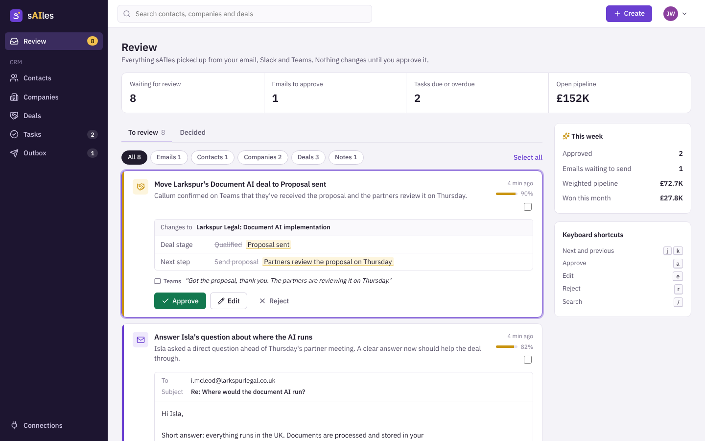
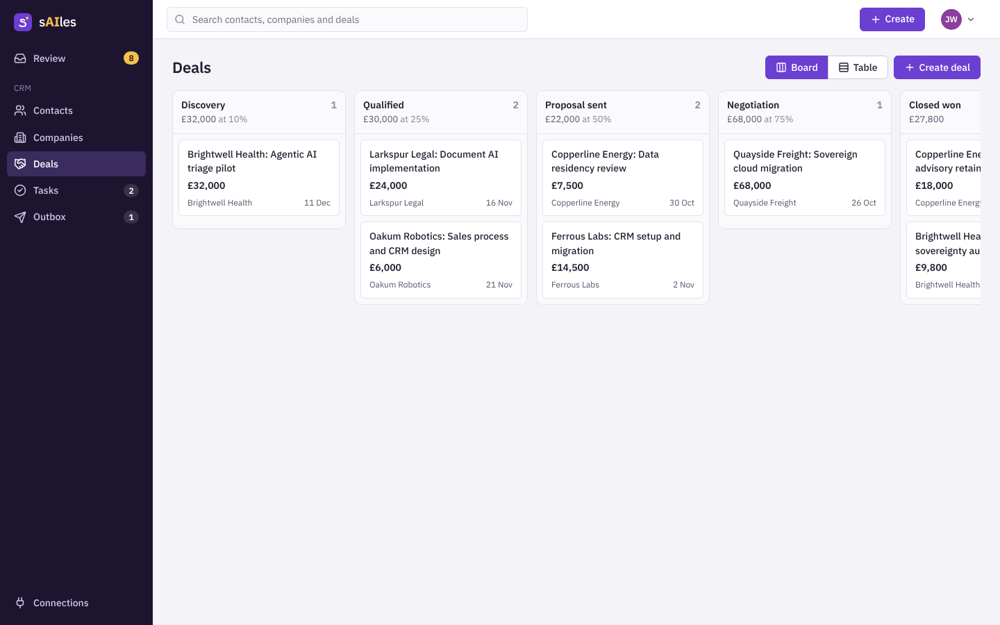
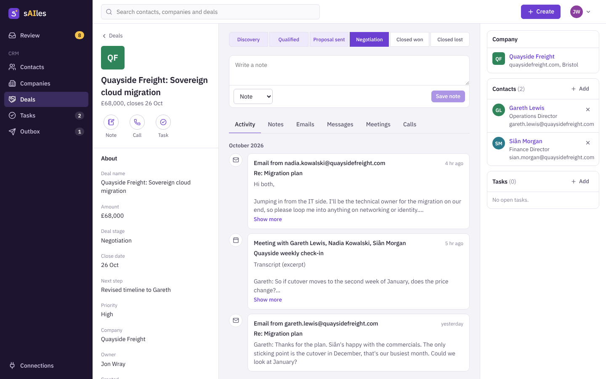

# sAIles

A self-hosted, open source CRM that fills itself in.

sAIles reads your email, Slack and Teams conversations (and meeting transcripts), works out who you're talking to and what's happening, and suggests the updates a good salesperson would make: new contacts and companies, deal stage changes, notes, follow-up tasks, and reply drafts written in your own tone of voice. Nothing touches your CRM until you approve it. Your day becomes one screen: review, tweak, approve.



## Status

Early alpha. This first stage is the CRM itself and the approval loop:

- Contacts, companies and deals with HubSpot-style tables, record pages and a drag-and-drop pipeline board
- An activity timeline on every record (emails, Slack and Teams messages, meetings, calls, notes)
- Tasks with due dates, overdue tracking and follow-ups
- **Review**: the approval queue. Every suggestion shows exactly what will change (before and after), why, how confident the AI is, and the message it came from. Approve, edit then approve, or reject with feedback. Keyboard shortcuts for speed.
- **Outbox**: approved emails wait here to be sent from your own mailbox
- Sign-in with server-side sessions; your data stays in your own Postgres

**Connectors, for now: Claude.** A scheduled Claude task reads your Outlook, Teams and Slack through Claude's own connectors, does the AI work (matching, suggestions, drafts in your voice), and swaps files with sAIles through a shared folder kept in sync by Syncthing. Approved emails come back to you as threaded Outlook drafts. See [the daily run](docs/claude-daily-run.md) and [the bridge format](docs/bridge.md).

Coming later: native Outlook (Microsoft Graph), Slack and Teams connectors and a built-in AI pipeline with local model support, for people running sAIles without Claude. They'll feed the same import format.

| Pipeline board | Record page |
| --- | --- |
|  |  |

## Run it

You need Docker with Compose.

```sh
git clone https://github.com/morningjon/sailes.git
cd sailes
cp .env.example .env        # then set POSTGRES_PASSWORD
docker compose up -d --build
```

Open http://localhost:8080 and create your account. The first account on a server becomes its admin.

To try it with fictional demo data, set `SAILES_SEED_DEMO=true` in `.env` before the first start. Set `SAILES_ADMIN_NAME` too and the demo email drafts are signed with your name.

### The shared folder

sAIles reads and writes the bridge folder at `SAILES_BRIDGE_HOST_DIR` (default `./bridge`). Point it at the server side of a Syncthing folder that's shared with the machine running Claude, and set `SAILES_UID`/`SAILES_GID` to the user that owns it (`id` shows them). sAIles creates the layout and a `README.md` describing the format on start.

If you put sAIles behind HTTPS (Caddy, Traefik, nginx), set `SAILES_SECURE_COOKIES=true`.

## Develop

Requirements: Rust (stable), Node 22, Postgres 16.

```sh
# Server on :8080 (runs migrations on start)
export DATABASE_URL=postgres://postgres@localhost:5432/sailes
export SAILES_SEED_DEMO=true
cargo run

# Dashboard on :5173, proxying /api to the server
cd web && npm install && npm run dev
```

Other server commands: `cargo run -- migrate` applies migrations only, `cargo run -- seed-demo` loads demo data into an empty database.

## How it fits together

```
 Outlook, Teams, Slack
        │  Claude's connectors
        ▼
 Claude daily run ──── shared folder (Syncthing) ────▶ sAIles
        ▲                                               │
        │                                               ▼
        │                              activities + suggestions (Review)
        │                                               │  you approve
        │                                               ▼
        └──── Outlook drafts ◀──── outbox ◀──── contacts, companies, deals, tasks
```

- `crates/server`: Rust (Axum, SQLx, Postgres). REST API under `/api`, serves the dashboard.
  - `fields.rs`: one whitelisted field spec per object, shared by the API and by approved proposals
  - `routes/proposals.rs`: the approval queue and how each kind of suggestion is applied
  - `bridge.rs`: the shared folder (imports, context export, outbox hand-off) and `POST /api/import`
  - `migrations/`: the schema
- `web`: React, TypeScript and Vite. The dashboard.

Connectors and the AI never write to CRM tables directly. They create proposals through `POST /api/proposals`, so a person always sees and approves the change.

## Licence

GPL-3.0-or-later. See [LICENSE](LICENSE).
